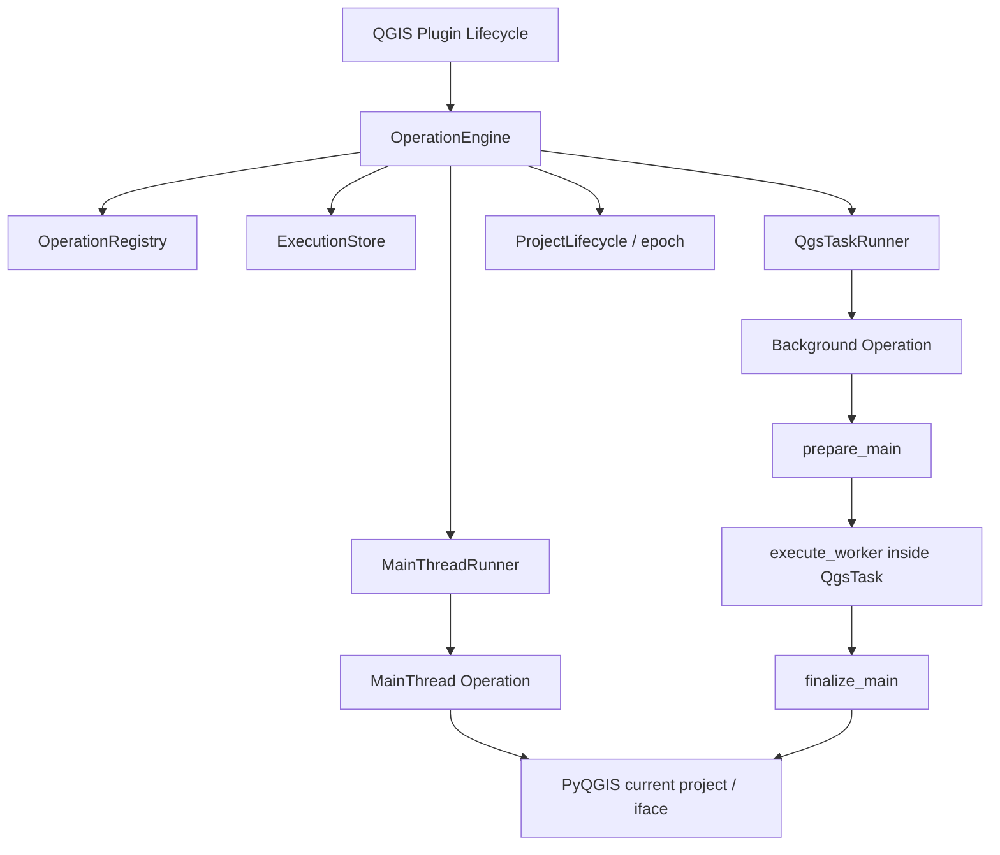

# QGIS 3.44 Agent Operation Framework — MVP 产品需求文档（PRD）

> **文档编号**：QGIS-AOF-PRD-001  
> **文档版本**：1.0（评审基线）  
> **编写日期**：2026-11-07  
> **目标 QGIS 版本**：QGIS 3.44.x，参考源码标签 `final-3_44_15`  
> **开发范围**：QGIS Desktop Python Plugin / PyQGIS；**不包含 CLI、MCP、网络 API 与 Agent Tool Adapter 的实现**  
> **文档性质**：约定 MVP 交付行为、接口契约和验收标准；不是已经通过 QGIS 运行环境验证的实现报告。

## 0. 文档使用规则与决策状态

本文将规则区分为：

- **MUST**：MVP 必须满足；违反则不能验收。
- **SHOULD**：推荐实现；若不采用，必须在代码评审中说明原因。
- **MAY**：可选能力，不作为 MVP 验收阻断条件。
- **OUT**：不属于 MVP；不能以未实现为由阻断验收。

本文中写作“产品决策”的内容，是本项目主动选择的契约，不应误认为 QGIS 官方原生行为。除特殊标注外，以下时间、容量和路径限制均为 MVP 产品决策，可在后续版本调整，但不得在同一版本中未经文档更新而改变。

## 1. 背景、问题与目标

### 1.1 背景

用户希望在 QGIS Desktop 插件中，使用 PyQGIS 将常用 GIS 能力封装为稳定、可发现、可校验的 Operation，作为后续 Agent Tool 的基础。当前已知 QGIS 自带 Python 环境中安装了 Pydantic，但其主版本尚未确认；MVP 应兼容经过验收的 Pydantic v1/v2，不能假设 QGIS 发行包在各平台拥有同一依赖版本。

### 1.2 要解决的问题

1. PyQGIS 原生 API 强依赖 QGIS 运行时、工程状态与 Qt 对象生命周期，难以直接暴露给外部调用者。
2. 部分 GIS 操作适合立即执行，部分需要异步执行，但 **异步调用不意味着可以在工作线程调用任意 PyQGIS API**。
3. `QgsTask` 有自己的任务生命周期和对象所有权；Operation 的执行记录不能依附于已完成的 `QgsTask` 对象。
4. 需要结构化的输入/输出与错误契约，避免未来 Tool 层依赖 QGIS QObject、SIP 包装对象或未经定义的异常文本。
5. 工程切换、图层删除、取消竞态和插件卸载必须有可验证的安全行为。

### 1.3 MVP 成功标准

- 在 QGIS 3.44 Desktop 中，插件加载后可通过 Python Console 访问一个统一的 `OperationRegistry` 与 `OperationEngine`。
- 具有独立的 `Command` / `Query` 业务语义和独立的同步/异步执行语义。
- `run_sync` 能在主线程完成低耗时操作；`submit` 能调度主线程事件队列任务及 `QgsTask` 后台任务。
- 统一生成可 JSON 序列化的 Pydantic Schema、结果、进度、错误和执行 ID。
- 在任务取消、工程切换、图层删除或插件卸载时，不崩溃、不向错误工程提交结果。
- 完成第 7 节规定的 9 个 Operation，且通过第 12 节验收。

## 2. 范围与非目标

### 2.1 P0：MVP 必须交付

1. 插件生命周期接入：`classFactory`、`initGui`、`unload`。
2. `BaseOperation`、`BaseCommand`、`BaseQuery`；主线程与后台执行能力协议。
3. `OperationRegistry`、`OperationEngine`、`MainThreadRunner`、`QgsTaskRunner`、内存执行记录仓库。
4. Pydantic v1/v2 兼容层；结构化异常与统一 JSON Schema 导出。
5. 主线程检查、任务进度、协作式取消、工程 epoch 失效保护和插件关闭保护。
6. `project.create/open/save/get_info` 与 `layer.add/list/get_info/set_visibility/sum_numeric_field`。
7. 可在真实 QGIS Desktop 中运行的集成测试及示例调用。

### 2.2 P1：明确延期

- 基于 `QgsProcessingAlgRunnerTask` 的 Processing Operation 适配与 `processing.buffer` 实例。
- 操作权限策略的多角色授权、按风险级别审批 UI。
- 图层渲染样式、要素编辑、地图视图控制、批量编辑、持久任务历史。
- 通用写入任务的冲突检测与补偿事务。

### 2.3 OUT：MVP 明确不做

- CLI、MCP、HTTP/WebSocket、Agent Tool SDK、Agent 本体或对外服务进程。
- 自定义线程池、直接启动裸 `QThread` 执行 GIS 业务、跨进程任务执行。
- 同步阻塞等待后台任务完成（尤其禁止在 GUI 主线程 `waitForFinished()`）。
- 完整 CQRS 的独立数据库读模型、事件溯源、通用 Undo/Redo/事务回滚。
- 任意远程数据源 URL、数据库连接字符串、任意 GDAL/OGR Provider、任意脚本/表达式执行。
- 崩溃后恢复正在运行的任务；跨 QGIS 会话持续有效的 `execution_id`。

## 3. 术语与语义契约

| 概念 | 唯一定义 | 不得混淆为 |
|---|---|---|
| `Operation` | 一个具名、具备输入输出模型的 GIS 业务能力 | Agent Tool 或 QGIS Task |
| `Command` | 意图是设置/改变用户可观察系统状态的 Operation；即使目标状态已存在仍是 Command | “一定修改成功”或“必须有返回值为空” |
| `Query` | 意图是获取信息、不得产生持久或用户可观察业务副作用的 Operation；内部只读缓存及日志允许 | “不耗 CPU/I/O” |
| `kind` | `COMMAND` 或 `QUERY`，描述业务意图 | 执行线程 |
| `strategy` | `MAIN_THREAD` 或 `BACKGROUND`，描述代码执行策略 | 调用方是否异步接收结果 |
| `run_sync` | 立即执行并在当前调用中返回终态 | 后台阻塞等待 |
| `submit` | 接受请求、生成 `execution_id`、排队执行，立即返回执行记录快照 | 强制在后台线程运行 |
| `QgsTask` | QGIS 工作线程任务容器与调度单元 | 执行记录数据库 |
| `ExecutionRecord` | 插件管理的、JSON 可序列化的调用状态快照 | `QgsTask` 对象 |
| `project_epoch` | 插件维护的当前工程生命周期代数，工程被清空/替换前递增 | 通用图层数据版本号 |
| `finalize_main` | 后台执行后在主线程完成结果验证/提交；可写业务状态 | 可以无条件提交结果 |

`read_only` 字段 **不保留**：`kind=QUERY` 已表达同一业务语义。`destructive` 独立存在，仅表示潜在丢弃/覆盖风险，不能替代实际授权或参数保护。

## 4. 源码与 API 核查结论

本章为已核对的 QGIS 3.44 官方事实，不是自定义架构规则。

| 编号 | 核对结论 | 设计影响 | 依据 |
|---|---|---|---|
| Q01 | `QgsProject.instance()` 是 QGIS Desktop 当前工程单例 | Context 默认引用单例，不为每次 Operation 新建独立项目 | [S2] |
| Q02 | `QgisInterface.newProject(promptToSaveFlag=False)` 创建空白工程，返回 `bool`；关闭旧工程时可能丢失数据 | `project.create` 需前置保护，不能直接无条件调用 | [S3] |
| Q03 | `QgsProject.addMapLayer(layer, addToLegend)` 成功返回图层，Python 绑定中工程接管图层所有权，并标记 dirty | 返回 `layer_id`，不得把 `QgsMapLayer` 持久化到结果 | [S2] |
| Q04 | 后台任务禁止使用属于主线程的 `QgsProject`、`QgsVectorLayer`、GUI QObject；需要事先复制数据 | 需要 `prepare_main → execute_worker → finalize_main` | [S4] |
| Q05 | `QgsTask.run()` 返回 bool；`finished(bool)` 总在主线程执行，但阻塞 GUI | 不抛异常离开 `run()`；主线程最终化应尽量短 | [S5] |
| Q06 | `QgsTask.cancel()` 属协作式取消；`isCanceled()` 需由工作逻辑检查 | 定义 `CANCEL_REQUESTED`，不宣称即时停止 | [S5] |
| Q07 | `QgsTaskManager.addTask()` 接管任务所有权；成功返回正整数 ID，失败返回 0；完成后清理 Task | `execution_id` 独立于 QGIS Task ID | [S4][S6] |
| Q08 | `QgsTaskManager` 是全局共享对象 | 只能取消本插件任务，不能 `cancelAll()` | [S4][S6] |
| Q09 | `QgsProject.aboutToBeCleared` 与 `cleared` 信号可用于识别工程生命周期变化 | 清空前递增 epoch；取消/失效相关任务 | [S2] |
| Q10 | `QgsProcessingAlgRunnerTask` 可运行 Processing 算法；context 与 feedback 必须持续存活 | P1 单独适配，不用自定义 Task 代替它的全部处理语义 | [S4][S7][S8] |
| Q11 | `QgsProject.read(path)`、`write(path)` 返回 bool，`write(path)` 影响当前工程关联文件 | 打开/保存不能被描述为纯函数或自动原子事务 | [S2] |

**特别修订**：先前原型把“`execute_worker` 返回后是否成功”与 Operation 总体成功混同。正式契约规定：`finalize_main` 结束且输出经 Pydantic 验证后，才能进入 `SUCCEEDED`。

## 5. 架构方案

### 5.1 分层



### 5.2 模块责任

| 模块 | 唯一责任 | 明确禁止 |
|---|---|---|
| `BaseOperation` | 描述业务能力、输入输出模型、种类和元数据 | 调度工作线程 |
| `BaseCommand` / `BaseQuery` | 表示业务语义 | 再重复存储 `read_only` |
| `OperationRegistry` | 注册、校验、发现、导出 Schema | 执行 GIS 业务 |
| `OperationEngine` | 验证输入、创建记录、调度、状态机、取消、最终化及关闭 | 在 worker 中直接操作 GUI |
| `MainThreadRunner` | QGIS 主线程直接/事件队列执行 | 将主线程 GIS 操作投递到线程池 |
| `QgsTaskRunner` | 封装 `QgsTask`、进度、取消、完成回调 | 长期保存结果或直接暴露 Task ID |
| `ExecutionStore` | 存储活动状态与有限终态历史 | 保存 QObject 或 SIP 包装对象 |
| `ProjectLifecycle` | 工程代数、工程变化通知 | 假装跟踪了所有数据内容的修订版本 |
| `OperationContext` | 提供主线程的 `iface/project/lifecycle/policy` | 传入后台 `execute_worker()` |

### 5.3 建议目录（P0）

```text
agent_qgis/
├── __init__.py
├── metadata.txt
├── plugin.py
├── core/
│   ├── contracts.py        # Operation、Command、Query、执行策略协议
│   ├── models.py           # Pydantic DTO 与错误码
│   ├── pydantic_compat.py  # v1/v2 validate/dump/schema
│   ├── context.py          # Main-thread context、lifecycle
│   ├── registry.py         # 注册/发现
│   ├── engine.py           # run_sync/submit/get/cancel/shutdown
│   ├── execution_store.py  # 独立执行记录
│   ├── security.py         # 文件路径、显式覆盖策略
│   └── runners/
│       ├── main_thread.py
│       └── qgs_task.py
├── operations/
│   ├── project.py
│   └── layer.py
└── tests/
    ├── unit/
    └── qgis_integration/
```

## 6. 公共协议与接口规范

### 6.1 输入输出模型

- 所有 `InputT/OutputT` **MUST** 继承 Pydantic `BaseModel`；额外输入字段 **MUST** 拒绝（`extra=forbid`）。
- JSON 数据只允许 `null/boolean/number/string/array/object`；不得暴露 `QObject`、`QgsMapLayer`、`QgsProject`、`QgsFeature`、Qt 枚举或 Python 异常对象。
- 输入布尔值必须为真正的 `bool`；模型字段应使用 `StrictBool`（v1/v2 均可用）阻止将字符串 `"true"` 等隐式转换为布尔值；需要严格字符串类型时使用 `StrictStr`。
- 输出必须经类型验证和 JSON 序列化；失败应产生 `OUTPUT_VALIDATION_FAILED` 而不是成功记录。
- Schema 由 Pydantic 自动生成；兼容层对 Pydantic v1 使用 `parse_obj/.dict()/.schema()` 等 API，对 v2 使用 `model_validate/model_dump(mode="json")/model_json_schema()`。**Schema 的 draft 差异在 P0 不标准化**，`OperationSpec` 必须同时暴露检测到的 Pydantic 主版本；未来 Tool Adapter 再转换。
- 运行时启动前 **MUST** 检查 Pydantic 主版本为 1 或 2，不匹配时插件应报告清晰的依赖错误而不是部分启动。

### 6.2 Operation 类型协议（规范性伪代码）

```python
class OperationKind(str, Enum):
    COMMAND = "command"
    QUERY = "query"

class ExecutionStrategy(str, Enum):
    MAIN_THREAD = "main_thread"
    BACKGROUND = "background"

class BaseOperation(ABC, Generic[InputT, OutputT]):
    name: str                 # 稳定注册键，例如 layer.add
    description: str          # 面向开发者与未来 Tool 的描述
    input_model: type[InputT]
    output_model: type[OutputT]
    kind: OperationKind       # 由 BaseCommand/BaseQuery 决定
    strategy: ExecutionStrategy
    destructive: bool = False

class BaseCommand(BaseOperation[InputT, OutputT]):
    kind = OperationKind.COMMAND

class BaseQuery(BaseOperation[InputT, OutputT]):
    kind = OperationKind.QUERY

class MainThreadOperationMixin(ABC, Generic[InputT, OutputT]):
    strategy = ExecutionStrategy.MAIN_THREAD
    @abstractmethod
    def execute_main(self, ctx: OperationContext, request: InputT) -> OutputT: ...

class BackgroundOperationMixin(ABC, Generic[InputT, OutputT, SnapshotT, WorkerT]):
    strategy = ExecutionStrategy.BACKGROUND
    @abstractmethod
    def prepare_main(self, ctx: OperationContext, request: InputT) -> SnapshotT: ...
    @abstractmethod
    def execute_worker(self, snapshot: SnapshotT, control: TaskControl) -> WorkerT: ...
    @abstractmethod
    def finalize_main(self, ctx: OperationContext, request: InputT, result: WorkerT) -> OutputT: ...
```

这段是接口签名，不是可直接复制运行的完整源码。实现者 **MUST** 明确把 `strategy` 设置为唯一值，Registry 注册时检查：`MAIN_THREAD` 实现 `execute_main`；`BACKGROUND` 实现全部三个阶段；不得同时声明两套执行能力。

`prepare_main` **MUST** 仅读取、校验并构造独立快照，不得产生持久业务写入；`execute_worker` **MUST NOT** 读取当前工程或 GUI QObject；`finalize_main` **MUST** 在主线程执行，可在成功完成工程/图层一致性检查后提交结果。P0 后台示例为只读 Query，因此不需要工程修改。

`TaskControl` 的公开能力仅有 `is_cancelled() -> bool` 与 `set_progress(value: float) -> None`。`value` 必须在 0–100 范围内，超界输入由 Adapter 截断；工作线程不得通过该对象获得项目、界面或执行记录的可变引用。

### 6.3 OperationSpec

| 字段 | 类型 | 必填 | 定义 |
|---|---|---|---|
| `name` | string | 是 | 唯一键，`^[a-z][a-z0-9_]*\.[a-z][a-z0-9_]*$` |
| `description` | string | 是 | 非空、可理解的操作描述 |
| `kind` | enum | 是 | `command/query` |
| `strategy` | enum | 是 | `main_thread/background` |
| `destructive` | bool | 是 | 是否可能丢弃/覆盖用户状态 |
| `input_schema` | object | 是 | Pydantic 输入 JSON Schema |
| `output_schema` | object | 是 | Pydantic 输出 JSON Schema |
| `pydantic_major` | int | 是 | 实际运行环境的主版本（1 或 2） |

`OperationSpec` **不包含** `read_only`、`tool_name`、网络协议地址或执行实例状态。

### 6.4 Registry 接口

```python
register(operation: BaseOperation) -> None
get(name: str) -> BaseOperation
list_specs() -> list[OperationSpec]  # 按 name 升序
get_spec(name: str) -> OperationSpec
```

- 重名注册抛 `DUPLICATE_OPERATION`；非法名称、缺失模型/方法、错误类型抛 `INVALID_OPERATION_DEFINITION`。
- `get/list_specs/get_spec` 不执行 PyQGIS 业务。
- `OperationSpec` 是副本；Registry 不返回可被外部修改的内部字典。
- P0 注册表在 `initGui()` 建立后保持静态；不支持运行时热注册/注销。

### 6.5 Engine 接口

```python
run_sync(name: str, arguments: dict) -> ExecutionRecord
submit(name: str, arguments: dict) -> ExecutionRecord
get(execution_id: str) -> ExecutionRecord
cancel(execution_id: str) -> CancelReceipt
shutdown() -> None  # 插件内部调用
```

**调用前置条件**：以上 Engine 方法均要求在 QGIS 主线程调用；`shutdown` 同样如此。P0 不提供从任意工作线程安全调度到 Engine 的公开方法。

| API | MAIN_THREAD | BACKGROUND | 返回 |
|---|---|---|---|
| `run_sync` | 立即在主线程执行直到终态 | **拒绝**，错误 `UNSUPPORTED_EXECUTION_MODE` | 终态记录 |
| `submit` | 通过 Qt 事件队列稍后执行 | 事件队列先准备快照，再提交 `QgsTask` | 当次创建的记录快照，通常 `QUEUED` |
| `get` | 按 ID 返回独立记录快照 | 同左 | `ExecutionRecord` |
| `cancel` | QUEUED 时可取消；RUNNING/FINALIZING 时拒绝 | QUEUED 可立即取消；SCHEDULED/RUNNING 仅发出协作取消请求；FINALIZING 拒绝 | `CancelReceipt` |

**控制面错误**（未知 Operation、无效 ID、非主线程调用、执行模式不支持、Engine 已关闭）抛框架异常 `FrameworkError(code, message)`，**不创建执行记录**。已通过控制面检查的具体调用若发生输入校验、GIS 操作、输出校验、提交失败，则创建 `ExecutionRecord` 并以 `FAILED` 结束。这样区分“调用本身无效”和“有效调用执行失败”。

`submit` **MUST** 在调用返回前完成 Operation 查找、容量检查与 Pydantic 输入验证；若输入校验失败，返回 `FAILED` 记录，不排队。成功接受的调用返回 `QUEUED`，后台快照准备不得在 `submit` 内同步展开。`run_sync` 的有效调用返回 `SUCCEEDED` 或 `FAILED`，不能返回中间状态。

### 6.6 ExecutionRecord

| 字段 | 类型 | 默认/限制 | 说明 |
|---|---|---|---|
| `execution_id` | UUID v4 string | 必填 | 会话内唯一；与 QGIS Task ID 无关 |
| `operation` | string | 必填 | 注册键 |
| `kind` | enum | 必填 | command/query |
| `strategy` | enum | 必填 | main_thread/background |
| `status` | enum | 必填 | 第 8 节定义的状态 |
| `progress` | float | 初始 0，0–100 | 非成功终态不自动改为 100 |
| `created_at` | ISO 8601 UTC string | 必填 | UTC，含时区 |
| `started_at` | ISO 8601 UTC / null | null | 开始执行时赋值 |
| `finished_at` | ISO 8601 UTC / null | null | 终态时赋值 |
| `project_epoch` | int | 必填 | 接受调用时的代数 |
| `result` | JSON object / null | null | 输出模型序列化结果 |
| `error` | `ErrorDetail` / null | null | 仅 FAILED 非空 |

状态不变量：

- `SUCCEEDED`: `result != null`、`error == null`、`progress == 100`、`finished_at != null`。
- `FAILED`: `result == null`、`error != null`、`finished_at != null`。
- `CANCELLED`: `result == null`、`error == null`、`finished_at != null`。
- 非终态：`finished_at == null`、`result == null`。
- 返回的是不可反向修改存储状态的**快照**；历史记录在同一次 QGIS 插件会话内可查。

`CancelReceipt` 字段为 `execution_id: str`、`accepted: bool`、`status: ExecutionStatus`、`reason: str | null`。`accepted=true` 仅表示取消请求被接受，**不等于已完成取消**。未知 ID 抛 `EXECUTION_NOT_FOUND`；已是终态返回 `accepted=false, reason="ALREADY_TERMINAL"`；主线程任务运行中返回 `accepted=false, reason="NOT_INTERRUPTIBLE"`；最终化阶段返回 `accepted=false, reason="FINALIZING"`。后台 `SCHEDULED` / `RUNNING` 转为 `CANCEL_REQUESTED`，并返回 `accepted=true`。

## 7. MVP Operation 逐项规格

### 7.1 总览

| Operation | Kind | Strategy | 风险 | 目标 |
|---|---|---|---|---|
| `project.create` | Command | MAIN_THREAD | destructive | 创建空白工程 |
| `project.open` | Command | MAIN_THREAD | destructive | 打开本地工程文件 |
| `project.save` | Command | MAIN_THREAD | destructive（可能覆盖） | 保存当前工程 |
| `project.get_info` | Query | MAIN_THREAD | 否 | 查询工程状态 |
| `layer.add` | Command | MAIN_THREAD | 否 | 添加本地 vector/raster |
| `layer.list` | Query | MAIN_THREAD | 否 | 列出项目图层 |
| `layer.get_info` | Query | MAIN_THREAD | 否 | 查询图层信息 |
| `layer.set_visibility` | Command | MAIN_THREAD | 否 | 改变图层树可见状态 |
| `layer.sum_numeric_field` | Query | BACKGROUND | 否 | 验证 QgsTask 的真实 GIS 查询样例 |

#### 通用输入约束

- 字符串不能为空；路径必须是绝对本地文件路径，标准化后位于允许目录下（第 10 节）。
- 文件访问遵守工作区白名单；默认不接受网络 URL、数据库 URI、`/vsicurl`、`/vsis3`、任意 GDAL/OGR 动态连接字符串。
- `project_epoch` **不由用户填写**，只由 Engine 记录与验证。
- Operation 的业务输出只返回基本数据类型，不返回 QGIS 对象。

### 7.2 `project.create`

**输入**：

```json
{"crs_authid":"EPSG:4326","discard_current":false}
```

| 字段 | 类型 | 默认 | 规则 |
|---|---|---|---|
| `crs_authid` | string | `EPSG:4326` | 必须能构造有效 `QgsCoordinateReferenceSystem` |
| `discard_current` | bool | `false` | 只有显式 `true` 才可替换存在业务内容/路径/未保存更改的工程 |

**保护条件**：当前工程有图层、关联文件名、dirty 状态或活动编辑缓冲区中任一成立时，若 `discard_current=false`，返回 `PROJECT_REPLACE_REQUIRED`，且不得调用 `iface.newProject()`。

**执行**：调用 `iface.newProject(promptToSaveFlag=False)`；若返回 `False` 则失败；成功后设置工程 CRS。若 CRS 无效，**必须在替换原工程之前拒绝**。

**输出**：`{"crs_authid":"EPSG:4326","file_path":null,"layer_count":0}`。新建不等于保存到磁盘。任何工程重建都会令旧 epoch 的待执行任务失效。

**失败安全**：替换启动后发生内部失败时，不承诺恢复旧工程；应产生明确错误并要求调用者重新读取工程状态。

### 7.3 `project.open`

**输入**：`{"path":"/workspace/maps/a.qgz","discard_current":false}`。

- `path`：绝对 `.qgs`/`.qgz` 普通本地文件，必须存在、可读、位于允许工程根目录内。
- `discard_current`：默认 `false`；替换旧工程时保护条件同 `project.create`。
- 禁止通过此 Operation 打开项目存储服务 URI；禁止弹出保存确认对话框。
- P0 实现选择在主线程调用 `QgsProject.instance().read(path)`，并通过工程信号更新生命周期；不依赖 `iface.addProject()` 可能引入的 GUI 交互路径。实现者 **MUST** 验证 QGIS GUI 图层树与地图画布对该调用正确响应。
- 成功输出：`{"file_path":"/workspace/maps/a.qgz","crs_authid":"EPSG:4326","layer_count":N}`。
- 读取失败返回 `PROJECT_OPEN_FAILED`；**不保证原工程不变**，不得伪称原子替换，应要求调用者重新执行 `project.get_info`。
- 已成功读取但包含无法加载的图层时，返回 `PROJECT_OPEN_FAILED`，附明确“工程可能已改变”标记，不能把“载入部分图层”误报为成功。验收数据应覆盖缺失数据源场景。

### 7.4 `project.save`

**输入**：`{"path":"/workspace/maps/output.qgz","overwrite":false}`。

- `path: string | null`，默认 `null`。为空表示保存到 `project.fileName()` 当前关联的文件，若没有关联文件则 `PROJECT_PATH_REQUIRED`。
- `overwrite: bool` 默认 `false`。目标文件已存在（即使是当前关联文件）且 `overwrite=false` 时，返回 `TARGET_EXISTS`。允许覆盖时必须显式传 `overwrite=true`。
- P0 仅允许 `.qgz` / `.qgs` 的本地文件保存；目标路径必须位于允许工程根目录内，父目录存在且可写；不创建父目录。
- 主线程调用 `project.write(path)` 或 `project.write()`；返回 `False` 时 `PROJECT_SAVE_FAILED`。
- 成功返回 `{"file_path":"...","is_dirty":false}`。
- **不得承诺写文件是原子操作**。出现磁盘写入异常时，目标文件可能部分写入或原文件可能已受到影响，错误说明必须保留此风险。

### 7.5 `project.get_info`

输入空对象 `{}`；输出：

```json
{"file_path":null,"crs_authid":"EPSG:4326","is_dirty":false,"layer_count":0,"project_epoch":0}
```

- `file_path` 是当前工程关联文件路径或 `null`；项目存储 URI 在 P0 不作路径转换。
- `project_epoch` 为插件本地当前代数，非 QGIS 内建工程版本号。
- 查询不得主动保存、改变活动图层或更改工程属性。

### 7.6 `layer.add`

**输入**：

```json
{"kind":"vector","source_path":"/workspace/data/roads.gpkg","name":"Roads","sub_layer":"roads","add_to_legend":true}
```

| 字段 | 类型 | 默认 | 规则 |
|---|---|---|---|
| `kind` | enum | 必填 | `vector` / `raster` |
| `source_path` | string | 必填 | 绝对、存在、可读、位于数据根目录内的本地文件 |
| `name` | string | 必填 | 非空，长度不超过 128 字符 |
| `sub_layer` | string/null | `null` | 仅 vector 允许；P0 仅接受字母、数字、下划线和连字符（1–64） |
| `add_to_legend` | bool | `true` | 是否创建图层树节点 |

- vector 固定 `ogr` Provider，raster 固定 `gdal` Provider。不得直接接受任意 `provider` 或原始 `source_uri` 作为 Agent 输入。
- 若 `sub_layer` 非空，内部为 GeoPackage 等支持子图层的 Provider 生成受控图层 URI；路径必须先独立校验，URI 不得来自未过滤字符串拼接。具体构造方式需在集成测试中验证含空格的路径。
- 构造 `QgsVectorLayer` 或 `QgsRasterLayer`，检查 `isValid()`，再调用 `QgsProject.addMapLayer()`。
- 成功输出：`{"layer_id":"...","name":"Roads","kind":"vector","provider":"ogr","crs_authid":"EPSG:4326"}`。
- `add_to_legend=false` 并不意味着图层一定处于“不显示”状态；该情形不创建图层树节点，`layer.set_visibility` 将拒绝。
- 不修改源数据文件，不负责重命名同名既有图层；QGIS 允许不同图层同名，因此后续统一使用 `layer_id`。

### 7.7 `layer.list`

输入 `{}`；输出：`{"layers":[LayerSummary, ...]}`。

每条 `LayerSummary` 必含：`layer_id`, `name`, `kind`（`vector/raster/other`）, `crs_authid`, `in_layer_tree`（bool）, `visible`（bool/null）, `effective_visible`（bool/null）。`visible` 严格定义为图层树节点的独立勾选状态，即 `itemVisibilityChecked()`；`effective_visible` 严格定义为图层节点及其祖先共同决定的实际可见状态，即 `isVisible()`。

- 排序：按 `layer_id` 字典序升序，保证稳定可测试；不把 QGIS `mapLayers()` 的迭代顺序视为 API 合约。
- 没有图层树节点时，`visible=null`, `effective_visible=null`, `in_layer_tree=false`，而不是假报 `false`。

### 7.8 `layer.get_info`

输入 `{"layer_id":"..."}`；输出字段：`layer_id`, `name`, `kind`, `provider`, `crs_authid`, `valid`, `in_layer_tree`, `visible`, `effective_visible`。两项可见性字段与 `layer.list` 完全一致。不存在则 `LAYER_NOT_FOUND`。

P0 不返回原始数据源 URI、连接凭据、全部要素、所有属性字段或大体量统计结果。

### 7.9 `layer.set_visibility`

输入 `{"layer_id":"...","visible":true}`；输出 `{"layer_id":"...","visible":true,"effective_visible":false,"changed":false}`（该示例表示父级图层组不可见，因此自身勾选为 true，但实际仍不可见）。

- 必须在主线程查找当前工程的图层树节点。
- 找不到图层返回 `LAYER_NOT_FOUND`；已注册但不在图层树内返回 `LAYER_NOT_IN_TREE`。
- 比较和设置的对象均是节点自身的 `itemVisibilityChecked()`；若目标状态已经一致，返回 `changed=false`；否则调用 `setItemVisibilityChecked(visible)` 并返回 `changed=true`。
- 输出的 `effective_visible` 使用 `node.isVisible()` 计算；父级组被隐藏时，`visible=true` **不保证** `effective_visible=true`。
- 不应改变其他图层节点或父级组的勾选状态；不修改图层数据源内容。

### 7.10 `layer.sum_numeric_field`（后台 Query 验证用）

输入 `{"layer_id":"...","field_name":"population"}`；输出：

```json
{"layer_id":"...","field_name":"population","count":125,"skipped_null":3,"total":51982.0,"snapshot_project_epoch":2}
```

- 仅支持有效的矢量图层、整型或浮点字段；其它类型返回 `INVALID_FIELD_TYPE`。
- `prepare_main` 在 QGIS 主线程读取数值、跳过 null，并复制成独立的 Python 数值元组；最多 10,000 个要素。超过上限返回 `SNAPSHOT_LIMIT_EXCEEDED`，**不允许静默截断**。
- 此操作的计算结果描述的是**快照数据**，不是任务完成时图层的实时值；`count` 是参与求和的非 null 数量，`skipped_null` 是跳过的 null 数量。
- `execute_worker` 只接收数值元组与 `TaskControl`，执行 Python 求和，周期性检查取消并汇报 0–100 进度。
- `finalize_main` 只验证执行仍处于同一 `project_epoch`，不写入工程。工程已替换则失败 `STALE_PROJECT`。
- `run_sync` 对此 Operation 必须拒绝；`submit` 必须使用真实的 `QgsTaskManager`。
- **性能声明**：该操作用于架构/线程/取消验收，不宣称为大图层高性能统计方案；未来采用 Provider 聚合或 Processing 专用算法替换。

## 8. 异步状态机与线程规范

### 8.1 状态与含义

| 状态 | 含义 | 终态 |
|---|---|---|
| `QUEUED` | 验证通过，等待主线程事件队列或 QGIS TaskManager 调度 | 否 |
| `PREPARING` | 主线程执行后台 Operation 的 `prepare_main` | 否 |
| `SCHEDULED` | 已成功提交 `QgsTaskManager`，等待真正开始 `QgsTask.run()` | 否 |
| `RUNNING` | 主线程直接执行，或 `QgsTask.run` 工作线程计算 | 否 |
| `CANCEL_REQUESTED` | 工作线程任务已接收取消请求，尚未确认退出 | 否 |
| `FINALIZING` | 工作线程结束后，主线程正在验证和处理结果 | 否 |
| `SUCCEEDED` | 全部阶段成功且输出验证通过 | 是 |
| `FAILED` | 参数/准备/运行/最终化/输出验证失败 | 是 |
| `CANCELLED` | 队列任务已移除，或工作线程确认取消并退出 | 是 |

### 8.2 合法状态迁移

| 当前状态 | 允许下一个状态 | 条件 |
|---|---|---|
| QUEUED | RUNNING | 主线程 Operation 开始执行 |
| QUEUED | PREPARING | 后台 Operation 开始准备快照 |
| QUEUED | CANCELLED | 任务还未开始即取消 |
| QUEUED | FAILED | 调度失败、Engine 关闭或前置条件失效 |
| PREPARING | SCHEDULED | 快照准备完成，QgsTask 提交成功（尚未必然开始执行） |
| PREPARING | FAILED | 快照验证/准备失败、QgsTask 提交失败 |
| SCHEDULED | RUNNING | `QgsTask.run()` 实际开始 |
| SCHEDULED | CANCEL_REQUESTED | 任务已交 QGIS 管理但尚未开始执行，收到取消请求 |
| SCHEDULED | FAILED | QGIS 报告调度/任务异常 |
| RUNNING | SUCCEEDED | 仅主线程 Operation 成功（其输出已验证） |
| RUNNING | FINALIZING | 后台 Task 返回成功，开始主线程收尾 |
| RUNNING | FAILED | 运行过程出错 |
| RUNNING | CANCEL_REQUESTED | 对可取消后台任务发出取消请求 |
| CANCEL_REQUESTED | CANCELLED | Task 确认终止/响应取消 |
| CANCEL_REQUESTED | FAILED | 任务发生真实异常，应优先保留失败原因 |
| FINALIZING | SUCCEEDED | 工程检查、结果应用、输出验证全部通过 |
| FINALIZING | FAILED | 工程失效、提交或输出验证失败 |

输入校验或容量拒绝发生在接受调用阶段，可以直接创建 `FAILED` 终态记录，不经过 `QUEUED`；这不是状态迁移。任何未列出的迁移均属程序缺陷。**所有状态更新必须在主线程**；后台线程仅使用 `TaskControl` 发出进度/取消信号，不直接编辑 `ExecutionStore`。

后台 Task 在 `run()` 返回 `True` 后，如此前已经接收到取消请求且尚未进入 `FINALIZING`，不得提交结果，应进入 `CANCELLED`；若 `run()` 抛异常则以实际 `FAILED` 优先保留诊断信息。进入 `FINALIZING` 后的取消请求返回拒绝，避免产生“已写入但报告取消”的歧义。

### 8.3 线程矩阵

| 动作 | 主线程 | 工作线程 |
|---|---:|---:|
| `OperationEngine` 公共方法 | **必须** | 禁止 |
| Pydantic 入参验证 | 必须 | 禁止（P0 统一入口） |
| `QgsProject`、`QgsMapLayer`、`iface` | 允许 | **禁止访问主线程实例** |
| `prepare_main` | **必须** | 禁止 |
| `execute_worker` | 禁止 | **必须** |
| `finalize_main` | **必须** | 禁止 |
| 进度事件产生 | 允许 | 允许，通过 `TaskControl` |
| 更新 ExecutionStore | **必须** | 禁止 |
| Qt GUI Widget | **必须** | 禁止 |
| 修改图层树、应用结果 | **必须** | 禁止 |

`submit` 的主线程任务使用 Qt 事件队列调度，不创建工作线程；它可能阻塞 GUI，不能用“异步提交”宣传其计算在后台执行。后台任务应避免同步准备大量数据，P0 限制最大 10,000 个要素快照。

### 8.4 QgsTask 适配器契约

- `OperationTask(QgsTask)` 的 `run() -> bool` 必须捕获全部 Python 异常并保存诊断信息；**不得让异常穿透到 QGIS C++ 任务框架**。
- `QgsTask.finished(bool)` 在主线程被调用，须把工作结果、取消标志和内部异常交给 Engine 的完成处理器；完成处理器必须自行捕获异常并归档状态。
- 进度使用 `QgsTask.setProgress()`；由 QObject 信号转送主线程，最大每 100 ms 刷新一次执行记录（最后一次进度与终态不受节流限制）。
- `QgsTaskManager.addTask()` 返回 0 则记录 `TASK_SUBMISSION_FAILED`；一旦返回非 0 ID，其对象所有权归 TaskManager，插件不得主动删除。
- Engine 使用 `execution_id → QGIS task ID` 映射仅用于活动任务定位，任务结束时释放映射，不保留 Task 指针为历史状态。
- 依赖图层的 Task 应调用 `setDependentLayers()`；工程即将切换时也主动取消旧 epoch 的任务。两者是互补措施，不能相互替代。

### 8.5 排队、取消和超时

- 活动后台任务上限：**2**（P0 产品配置默认值），仅计算进入 `SCHEDULED/RUNNING/CANCEL_REQUESTED/FINALIZING` 的后台任务；其余后台调用保留在 Engine 的 `QUEUED` 内，空位出现后按提交先后顺序（FIFO）开始 `PREPARING`。
- 插件所有尚未开始执行的 Engine 队列任务上限：**32**（含主线程与后台队列）。主线程队列使用 Qt 下一轮事件分发，不等待后台名额；超额返回 `TOO_MANY_EXECUTIONS` 的 `FAILED` 记录，不能悄悄丢请求。
- 终态记录最多保留 **200** 条或 **30 分钟**（先达到者淘汰）；活动记录不可淘汰；`get` 查询已淘汰 ID 返回 `EXECUTION_NOT_FOUND`。
- P0 不强制终止运行中的线程，也不提供“执行超过 N 秒就杀死任务”的行为。
- `cancel` 对后台任务仅通知 `QgsTask.cancel()` 并转为 `CANCEL_REQUESTED`；工作函数须周期性检查 `isCanceled()`。
- `cancel` 在 Engine 自己管理的 `QUEUED` 时立即标记 `CANCELLED`；队列中残留的 Qt 回调必须通过检查状态后立即跳过。
- 对已经交给 `QgsTaskManager` 的 `SCHEDULED` 任务，`cancel` 仅转为 `CANCEL_REQUESTED` 并调用 `QgsTask.cancel()`；直到 QGIS 确认终止后才能转为 `CANCELLED`。
- `cancel` 在主线程 `RUNNING` 时拒绝（主线程事件正在执行，通常无法同时运行取消请求）。

## 9. 工程生命周期、并发与关闭

### 9.1 project_epoch

- 插件启动时 `project_epoch = 0`；连接 `QgsProject.aboutToBeCleared`，每次接到信号立即递增 epoch。
- P0 仅通过 `aboutToBeCleared` 增加 epoch，不再同时通过 `cleared` 等信号重复计数；每次该信号到达就递增一次，**不要求与人类感知的一次“打开工程”一一对应**。要求的是单调增加、旧代数任务失效。若某个具体工程替换路径没有触发该信号，则该路径不予验收，必须在合并前调整监听策略并更新本文。
- 每个执行记录创建时捕获 epoch；后台工作开始前、最终化前都要校验 epoch。旧 epoch 结果一律禁止提交当前工程。
- 当前设计只检查“工程是否替换”，**不**发现同一工程内部的所有图层属性或要素变化。需要严格一致性的后台写操作属于 P1，必须引入额外版本/冲突检测。

### 9.2 同期操作

- 所有 MAIN_THREAD Operation 串行落在 Qt 主线程事件循环中；如果某个同步调用耗时较长，GUI 可能被阻塞。
- BACKGROUND Operation 可同时最多 2 个，但它们不得写当前工程；首版仅开放后台 Query。
- 当前工程重建时，所有旧 epoch 的 QUEUED 任务立即 CANCELLED；SCHEDULED/RUNNING 后台任务请求取消；已经计算完但尚未提交最终结果者必须先校验 epoch，若未进入取消终态则 FAILED(`STALE_PROJECT`)，绝不应用结果。
- 不允许后台结果根据名称重新定位“相似图层”并应用；必须使用最初记录的 project epoch 和 `layer_id`。

### 9.3 插件 `unload()`

1. 在主线程切换 Engine 为 `CLOSING`，拒绝新请求。
2. 取消尚未运行的主线程任务；对本插件所有活动 `QgsTask` 调用 `cancel()`；不得调用全局 `taskManager.cancelAll()`。
3. 禁止此后所有完成回调修改工程、画布或插件 UI；允许后台回调只做状态归档、资源清理。
4. 用受 Qt 主应用生命周期托管的 Runtime/Supervisor 保留活动 Task 的 Python 回调、`QgsProcessingContext`/feedback（如果未来启用）以及必要状态，直至任务真正终止；不能只把引用保存在即将销毁的 Plugin 实例上。
5. 最后一个活动任务终止后，通过主线程 Qt 生命周期机制清理 Supervisor。不得通过阻塞 GUI 等待任务结束。
6. 必须有“卸载后仍有后台任务运行”和“重复启用/卸载插件”的集成测试。

**限制说明**：协作式取消无法保证某个完全不检查取消的第三方任务立即结束。本插件仅调度自己受控的、周期性检查取消的 P0 工作函数；不能宣称支持强制线程终止。

## 10. 文件访问与安全约束

### 10.1 配置项（P0）

| 配置键 | 默认值 | 语义 |
|---|---|---|
| `allowed_data_roots` | 空列表 | 可读取矢量/栅格数据的绝对目录 |
| `allowed_project_roots` | 空列表 | 可打开/保存项目的绝对目录 |
| `max_active_background` | 2 | 本插件同时运行的后台 Task 数 |
| `max_pending` | 32 | 本插件排队任务上限 |
| `max_terminal_records` | 200 | 终态历史上限 |
| `terminal_ttl_seconds` | 1800 | 终态记录最长保留时间 |
| `max_snapshot_features` | 10000 | 后台统计示例快照要素上限 |

两个允许目录默认都是空，代表**默认拒绝文件访问**。开发调试者通过插件本地配置（如 `QgsSettings`）明确设置允许根目录；P0 不要求配置界面。

### 10.2 路径规范

- 输入路径必须是绝对路径；经 `Path.resolve(strict=...)` 规范化，并使用路径组件比较确认位于白名单根目录（不能用简单字符串前缀判断）。
- 读取时目标必须存在且为普通文件；保存时允许目标不存在，但父目录必须存在且属于白名单，已有目标需要明确 `overwrite=true`。
- 路径含符号链接必须按规范化后的真实目标验证；禁止通过链接跳出允许目录。
- 不接受 HTTP(S)、PostGIS、WMS/WFS、数据库密码 URI、GDAL VSI 远程路径、Provider 自定义连接字符串。
- 对输入错误和异常日志中的路径进行最小化处理；不得写出隐藏在原始 Provider URI 中的凭据。
- 即使文件位于允许目录，也仍需执行真实 `isValid()` / `read()` 校验。允许根目录不是文件合法性保证。

### 10.3 破坏性操作

- `project.create` / `project.open`：只允许显式 `discard_current=true` 时替换有状态的当前工程。
- `project.save`：只允许显式 `overwrite=true` 时覆盖现有目标文件。
- 默认所有具有破坏性的行为都“拒绝而不是弹模态确认框”。未来 Agent 用户确认流程放到适配层，但不能弱化插件内的参数校验。

## 11. 错误协议与可观察性

### 11.1 规范错误结构

```json
{"code":"LAYER_NOT_FOUND","message":"Layer does not exist","details":{"layer_id":"..."}}
```

- `code` 为稳定机器可读常量，英文大写加下划线。
- `message` 为简明可读文本，不得承诺回滚成功。
- `details` 为可选、小体量、JSON 可序列化的安全字段对象；不得包含 traceback、令牌、完整 SQL、未脱敏 Provider URI。
- 非预期异常统一为 `INTERNAL_ERROR`，详细堆栈仅写本机受控日志。

### 11.2 最小错误码集合

| 错误码 | 触发场景 |
|---|---|
| `OPERATION_NOT_FOUND` | Registry 中无该名称（控制面异常） |
| `INVALID_OPERATION_DEFINITION` | 注册声明不完整（启动/注册异常） |
| `DUPLICATE_OPERATION` | 重复名称（注册异常） |
| `WRONG_THREAD` | Engine API 从非主线程调用（控制面异常） |
| `ENGINE_CLOSING` | Plugin 正在卸载（控制面异常） |
| `UNSUPPORTED_EXECUTION_MODE` | 对 BACKGROUND 调 `run_sync`（控制面异常） |
| `EXECUTION_NOT_FOUND` | 执行 ID 不存在或已淘汰（控制面异常） |
| `INVALID_INPUT` | 参数 Pydantic 验证失败 |
| `INVALID_CRS` | 坐标系统无效 |
| `PROJECT_REPLACE_REQUIRED` | 替换当前有状态工程但未显式授权 |
| `PROJECT_OPEN_FAILED` | QGIS 读取项目失败或项目关键图层不可用 |
| `PROJECT_SAVE_FAILED` | QGIS 保存失败 |
| `PROJECT_PATH_REQUIRED` | 保存时未指定路径且工程无关联路径 |
| `TARGET_EXISTS` | 覆盖目标时未显式允许 |
| `PATH_NOT_ALLOWED` | 文件路径违反允许目录或 URI 限制 |
| `INVALID_LAYER` | 图层数据源无效 |
| `LAYER_NOT_FOUND` | 图层 ID 不存在 |
| `LAYER_NOT_IN_TREE` | 图层已注册但无图层树节点 |
| `INVALID_FIELD_TYPE` | 统计字段非数值 |
| `SNAPSHOT_LIMIT_EXCEEDED` | 后台输入快照超上限 |
| `TOO_MANY_EXECUTIONS` | 队列/并发限制 |
| `TASK_SUBMISSION_FAILED` | QGIS TaskManager 拒绝提交 |
| `STALE_PROJECT` | 工程已更换，禁止使用旧结果 |
| `OUTPUT_VALIDATION_FAILED` | Operation 输出未符合声明模型 |
| `INTERNAL_ERROR` | 未预期异常 |

### 11.3 日志与调试

- 每次执行需记录：`execution_id`、`operation`、`strategy`、状态迁移、耗时、错误码。
- 默认不记录完整参数字典；路径等敏感信息只在专门启用的调试模式中脱敏输出。
- Engine 的异常捕获必须覆盖 `prepare_main`、`execute_worker`、`finalize_main`、输出序列化和任务提交回调。
- 支持通过 Python Console 手动查询 `get(id)`，不要求图形任务面板。

## 12. 测试计划与验收标准

### 12.1 测试环境

- 至少一个真实 **QGIS Desktop 3.44.x GUI** 环境；测试记录 `QGIS_VERSION_INT`、Python、Qt、Pydantic 版本。
- 用测试临时目录配置 `allowed_data_roots` 和 `allowed_project_roots`，准备有效/损坏的 GeoPackage、GeoTIFF 与 QGZ 文件。
- 纯 Python 层用伪 Operation 测 Registry、状态机和 Pydantic；线程/Task/工程生命周期必须使用真实 QGIS 的 Qt 事件循环测试。
- 运行时文件操作应使用测试数据，禁止把现有用户工程作为破坏性测试对象。

### 12.2 P0 必须通过的用例

| ID | 场景 | 预期结果 |
|---|---|---|
| AT-01 | 注册两个同名 Operation | `DUPLICATE_OPERATION`，原注册未被覆盖 |
| AT-02 | 输入含未知字段/错误 bool 类型 | FAILED(`INVALID_INPUT`)，不发生 GIS 副作用 |
| AT-03 | 主线程 `run_sync(project.get_info)` | SUCCEEDED，终态记录有效 |
| AT-04 | 主线程 `submit(layer.add)` | 初始 QUEUED，事件循环后 SUCCEEDED，图层已注册 |
| AT-05 | `run_sync(layer.sum_numeric_field)` | 拒绝 `UNSUPPORTED_EXECUTION_MODE`，不创建 Task |
| AT-06 | `submit(layer.sum_numeric_field)` | 实际创建 `QgsTask`，进度可查询，结果与基准求和一致 |
| AT-07 | 后台 Worker 抛异常 | FAILED；QGIS GUI 进程不崩溃，未留下 RUNNING 记录 |
| AT-08 | 工作中取消后台任务 | CANCEL_REQUESTED，最终 CANCELLED；不应用结果 |
| AT-08B | 后台 Task 已提交 QGIS 但还未开始运行时取消 | SCHEDULED→CANCEL_REQUESTED→CANCELLED，不提前宣布已终止 |
| AT-08C | 同时提交 3 个后台任务（并发上限 2） | 最多 2 个 SCHEDULED/RUNNING，第三个 QUEUED，依 FIFO 后续调度 |
| AT-09 | QUEUED 主线程任务取消 | 立即 CANCELLED；后续 Qt 回调不得执行该 Operation |
| AT-10 | 在 FINALIZING 请求取消 | `accepted=false, reason=FINALIZING`；状态机不非法跳转 |
| AT-11 | 后台任务期间打开/新建另一工程 | 旧任务不得向新工程提交任何结果；适用时 FAILED(STALE_PROJECT) 或 CANCELLED |
| AT-12 | 图层在后台运行期间删除 | 关联 Task 收到取消；无无效 SIP 对象访问/崩溃 |
| AT-13 | 插件卸载后工作线程尚未终止 | 无 UAF/崩溃；不再修改项目或 GUI；Supervisor 最终清理 |
| AT-14 | QGIS TaskManager 提交返回 0（模拟） | FAILED(TASK_SUBMISSION_FAILED)，没有悬挂执行记录 |
| AT-15 | 有状态工程 `project.create(discard_current=false)` | 失败且原工程保持不变 |
| AT-16 | 有状态工程显式替换 | SUCCEEDED，图层归零，epoch 增加 |
| AT-17 | `project.save(overwrite=false)` 目标已存在 | FAILED(TARGET_EXISTS)，目标文件字节未改变 |
| AT-18 | 打开损坏项目 | FAILED(PROJECT_OPEN_FAILED)，报告当前工程状态可能已改变，不崩溃 |
| AT-18B | `read(path)` 返回 true，但有注册图层 `isValid()==False` | SUCCEEDED，输出 `invalid_layer_count>0`，不得声称所有数据源均有效 |
| AT-19 | 允许目录外、软链接越界、网络 URI | FAILED(PATH_NOT_ALLOWED)，未加载或写入文件 |
| AT-20 | `layer.add` 无效本地数据源 | FAILED(INVALID_LAYER)，工程图层数不变 |
| AT-21 | `layer.list` 有已注册但不在树中的图层 | `in_layer_tree=false`、`visible=null` |
| AT-21B | 图层勾选 true，但上级组勾选 false | 输出 `visible=true, effective_visible=false`；`set_visibility` 不修改父级组 |
| AT-22 | `layer.set_visibility` 同状态重复调用 | SUCCEEDED，`changed=false` |
| AT-23 | 后台输出/最终化异常 | FAILED，不能错误标记 SUCCEEDED |
| AT-24 | 200 条终态上限与 1800 秒 TTL | 活动记录保留；被淘汰 ID 返回 EXECUTION_NOT_FOUND |
| AT-25 | 连续加载/卸载插件 3 次 | 无重复 Qt 信号连接、重复注册或残留 UI/Task 回调 |
| AT-26 | 工作线程直接调用 Engine API | `WRONG_THREAD`；不碰 GUI/QgsProject |
| AT-27 | Pydantic v1 与 v2 各运行兼容层测试 | 输入验证、JSON 导出与输出序列化正确 |

### 12.3 P0 质量门槛

- **零崩溃**：所有 AT 用例不得造成 QGIS 原生进程崩溃。
- **零错误提交**：旧 epoch 后台任务不得向当前新工程应用结果。
- **零未定义状态**：任何执行记录都不得发生非法状态迁移或在任务已完成时永久停留 RUNNING。
- **100% P0 验收用例通过**，包括 Task 真实运行、取消与插件卸载场景。
- **有据可查**：所有正式运行环境中完成测试的结论应记录 QGIS/Python/Pydantic 版本；未执行的测试不能标记“通过”。

## 13. 里程碑、实施顺序与交付物

| 阶段 | 主要交付 | 退出条件 |
|---|---|---|
| M1：协议与注册 | BaseOperation/Command/Query、Models、Pydantic 兼容、Registry | AT-01、AT-02、AT-27 |
| M2：同步主线程 | Context、Engine、MainThreadRunner、工程和图层基本操作 | AT-03、AT-15～AT-22 |
| M3：异步主线程 | Qt 队列、ExecutionStore、查询与取消 | AT-04、AT-09、AT-24、AT-26 |
| M4：QgsTask | 后台协议、Task adapter、进度、取消、异常保护 | AT-05～AT-08、AT-10、AT-14、AT-23 |
| M5：生命周期与发布 | project_epoch、图层依赖、卸载 Supervisor、文档与端到端测试 | AT-11～AT-13、AT-25，所有 AT 通过 |

交付物：可加载的 QGIS 3.44 Plugin 源码、开发安装说明、9 个 Operation 的 Pydantic Schema、Python Console 调用样例、测试代码与测试报告、错误码文档。

## 14. 设计审查结论与明确放弃的方案

| 原想法/风险 | 正式决策 | 原因 |
|---|---|---|
| Command 与 Query 仅用 `read_only` 区分 | 使用独立 `kind` 与两个基类 | 明确业务语义，不与运行方式耦合 |
| 所有 Operation 都定义 `execute(ctx, input)` | 分主线程和后台能力协议 | 防止将项目 QObject 带入 QgsTask.run |
| 异步全部交给 QgsTask | 主线程异步采用 Qt 队列，计算型用 QgsTask | 不能用工作线程执行所有 GIS API |
| `run_sync` 阻塞等待 QgsTask | 明确拒绝 BACKGROUND Operation | 避免 GUI 阻塞/等待完成回调死锁风险 |
| 返回 Qt/QGIS 对象 | 仅返回 Pydantic JSON DTO | 生命周期与序列化安全 |
| 任务状态直接取 `QgsTask.status()` | 自有 ExecutionRecord 和 UUID | QGIS Task 生命周期短，主线程队列无 Task |
| `cancel()` 立即视为成功取消 | 区分 CANCEL_REQUESTED/CANCELLED | 协作式取消且存在竞态 |
| QgsTask.run 成功即 Operation 成功 | finalize_main 与输出校验后才成功 | 防止后台数据已算出但结果提交失败 |
| 使用 epoch 解决全部并发 | 仅解决项目生命周期，P1 扩展图层修订检查 | 不伪称 epoch 是统一数据版本 |
| `source_uri` 任意透传给 OGR/GDAL | P0 只接受受控本地路径与有限参数 | 限制网络/文件权限与注入面 |
| `project.save` 自动覆盖已有文件 | 默认拒绝，显式 overwrite | 防止不可逆文件损失 |
| unload 直接销毁所有插件对象 | 独立 Runtime/Supervisor 等待受控 Task 自然结束 | QgsTaskManager 接管任务且取消不保证即时 |
| 首版直接统一 Processing | P1 使用原生 QgsProcessingAlgRunnerTask 独立适配 | 其自身有 prepare/runPrepared/postProcess 语义和 context 生命周期 |

## 15. API 调用示例（示意，不宣称已运行）

```python
# 在 QGIS 主线程中的插件调用方
info = engine.run_sync("project.get_info", {})
assert info.status == ExecutionStatus.SUCCEEDED

# 安全添加图层：需事先配置 allowed_data_roots
submitted = engine.submit("layer.add", {
    "kind": "vector",
    "source_path": "/workspace/data/roads.gpkg",
    "name": "Roads",
    "sub_layer": "roads",
    "add_to_legend": True,
})
# 由 Qt 事件循环推进任务；之后查询：
latest = engine.get(submitted.execution_id)

# 真正由 QgsTask 执行的 GIS 只读统计
job = engine.submit("layer.sum_numeric_field", {
    "layer_id": "<from layer.add result>",
    "field_name": "population",
})
# 可以在 QGIS 主线程查询/取消：
receipt = engine.cancel(job.execution_id)
```

MVP 不提供“阻塞轮询直到完成”的工具方法。示例中的 `get` 应在 Qt 事件循环继续运行后调用，而不是在主线程进行忙等待。

## 16. 参考资料（官方资料，访问核对日期 2026-11-07）

- **[S1]** QGIS 3.44.15 源码版本：https://github.com/qgis/QGIS/tree/final-3_44_15
- **[S2]** `QgsProject` PyQGIS 3.44 API：https://qgis.org/pyqgis/3.44/core/QgsProject.html
- **[S3]** `QgisInterface` PyQGIS 3.44 API：https://qgis.org/pyqgis/3.44/gui/QgisInterface.html
- **[S4]** QGIS 3.44 PyQGIS Tasks Cookbook：https://docs.qgis.org/3.44/en/docs/pyqgis_developer_cookbook/tasks.html
- **[S5]** `QgsTask` PyQGIS 3.44 API：https://qgis.org/pyqgis/3.44/core/QgsTask.html
- **[S6]** `QgsTaskManager` PyQGIS 3.44 API：https://qgis.org/pyqgis/3.44/core/QgsTaskManager.html
- **[S7]** `QgsProcessingAlgRunnerTask` PyQGIS 3.44 API：https://qgis.org/pyqgis/3.44/core/QgsProcessingAlgRunnerTask.html
- **[S8]** QGIS 3.44.15 Processing Task 源码：https://github.com/qgis/QGIS/blob/final-3_44_15/src/core/processing/qgsprocessingalgrunnertask.cpp
- **[S9]** QGIS 3.44.15 TaskManager 源码：https://github.com/qgis/QGIS/blob/final-3_44_15/src/core/qgstaskmanager.cpp
- **[S10]** `QgsLayerTreeNode` 可见性 API：https://qgis.org/pyqgis/3.44/core/QgsLayerTreeNode.html

> **最终设计原则**：Operation 描述“做什么”；Command/Query 描述业务意图；Runner 描述“在哪里执行”；Engine 描述“如何调度、查询、取消和结束”；QgsTask 只是后台执行机制，未来 Tool 是能力暴露/组合层。以上边界是 MVP 的规范，不随具体 Command 实现变化。
